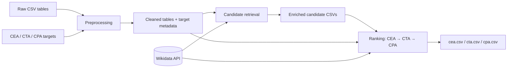

# The Role of Small Language Models in Web Table Interpretation

Research code accompanying **Yang Lei's master's thesis in Data Science**, supervised by **Pr. Christophe Debruyne**, academic year **2025–2026**.

This repository investigates **where small language models help in Semantic Table Interpretation (STI)**. It implements a modular pipeline that links CSV tables to Wikidata, compares deterministic methods with model-assisted methods, and evaluates each stage separately. In the thesis, an SLM is an instruction-tuned model with fewer than 10 billion parameters, intended for deployment on a single GPU.

The central finding is stage-dependent: deterministic cleaning preserves useful input, SLM-generated search labels improve candidate retrieval, and task-adapted SLMs improve ambiguous ranking decisions. The purpose is to study those contributions and their propagation through the pipeline.

## Contents

- [Tasks and pipeline](#tasks-and-pipeline)
- [Main results from the thesis](#main-results-from-the-thesis)
- [Repository layout](#repository-layout)
- [Environment and prerequisites](#environment-and-prerequisites)
- [Input data and output formats](#input-data-and-output-formats)
- [Running the pipeline](#running-the-pipeline)
- [Configuration reference](#configuration-reference)
- [Fine-tuning](#fine-tuning)
- [Evaluation and experimental protocol](#evaluation-and-experimental-protocol)
- [Reproducibility and limitations](#reproducibility-and-limitations)

## Tasks and pipeline

The pipeline covers three SemTab tasks:

| Task | Input to annotate | Expected answer |
|---|---|---|
| **CEA — Cell Entity Annotation** | A target cell | The Wikidata entity represented by its value, identified by a QID |
| **CTA — Column Type Annotation** | A target column | A Wikidata class describing the column, also identified by a QID |
| **CPA — Column Property Annotation** | An ordered pair of columns | The Wikidata property connecting subject and object values, identified by a PID |

Target files identify **what must be annotated**. Ground-truth files contain the reference answers and are used for evaluation or training-data construction, rather than as annotation inputs.



### 1. Preprocessing

[Preprocessing](Pipeline_semtab/Preprocessing/README.md) removes HTML tags, redundant whitespace and wrapping artefacts, optionally applies SLM typo correction, and appends a `Metadata:` column describing the annotation targets. CTA columns and CPA column pairs are encoded in its header; each row contains the column indices of its CEA targets.

The reference configuration uses `NEED_CORRECTTYPO:false`: only deterministic cleaning and target marking are performed. In the evaluated configurations, model-based corrections damaged more useful values than they repaired, reducing downstream retrieval coverage.

### 2. Candidate retrieval

[Candidate retrieval](Pipeline_semtab/Candidate_Retrieval/README.md) builds a deduplicated list of Wikidata entities for each target cell. It combines configurable generators:

| Generator | Operation | Default quality rank |
|---|---|---|
| `direct` | Search Wikidata with the cell value | 1 |
| `llm` | Generate alternative entity labels using the cell and row context, then search Wikidata for those labels | 2 |
| `fuzzy` | Search deterministic surface variants, such as reordered names or shortened labels | 3 |

The SLM proposes **search labels**, which the API resolves to QIDs. This stage uses Wikidata search rather than a vector database. Generator order and activation are configurable; the chained example uses `direct,llm`, with fuzzy search disabled.

With enrichment enabled, each candidate receives its description, aliases, `P31` (instance of), `P279` (subclass of), and sitelink count. These fields support later similarity and type-coherence scoring. `SEARCH_LIMIT` limits results **per search query**; `MAX_CANDIDATES_PER_CELL` limits the deduplicated set across generators, with `0` meaning no cap.

### 3. Ranking and annotation

[Ranking](Pipeline_semtab/Ranking/README.md) first scores candidates using the default heuristic:

```text
score = 0.5 × string_similarity + 0.2 × (1 / quality_rank) + 0.3 × type_coherence
```

String similarity compares the mention with the candidate label and aliases using normalised Levenshtein similarity and, for the label, token Jaccard similarity. Type coherence measures support for the candidate's types across the column; `P279` coverage is down-weighted. The features, weights and quality transformation can be changed in the configuration.

The annotation strategy then controls model intervention:

| Strategy | CEA decision |
|---|---|
| **No SLM** | Keep the highest heuristic score. Implemented as `METHOD:limited_slm` with all three `*_USE_SLM` flags disabled. |
| `limited_slm` | Keep the heuristic answer unless the leading scores are too close; ask the SLM to resolve those cases. |
| `slm_context` | Gate the SLM on score uncertainty and provide a local table window, the marked target cell and column information. |
| `full_slm` | Ask the SLM to select from the top candidates for every cell, with optional verification. |

In the standard WikidataTables configurations, an unusable model response falls back to the heuristic answer. The ranking model selects from the retrieved shortlist, so it cannot recover a gold entity missing from that list.

CTA aggregates `P31`/`P279` type coverage, optionally recomputed from the entities selected by CEA (`CTA_FROM_SELECTION`). An SLM can resolve close type scores. CPA matches Wikidata claims of the selected subject entities against object entities or literal values, then votes across rows. Its SLM intervention is restricted to tied leading properties; a pair with no supporting claim remains unannotated.

The separate [direct baseline](Pipeline_semtab/Baseline_direct/README.md) asks a model to generate QIDs/PIDs directly from the table, bypassing candidate retrieval and ranking.

## Main results from the thesis

The following values are **reported thesis results**, not scores automatically reproduced by the default launch command. The main development set is **WikidataTables2024R1 Valid**, with **4,247 CEA target cells**.

At retrieval time, *maximum recall* is the fraction of target cells whose gold entity occurs anywhere in the candidate set. It measures candidate coverage, not the F1 of the final annotations.

| Retrieval configuration | Maximum recall |
|---|---:|
| Qwen2.5 3B, without adaptation, search limit 10 | 0.860 |
| Qwen2.5 3B, LoRA, search limit 10 | 0.869 |
| GLM4 9B, without adaptation, search limit 10 | 0.869 |

Source: thesis Tables 6.5 and 6.8. These configurations combine direct and SLM search. A larger search limit can increase coverage while also increasing the candidate set and downstream work.

| Ranking configuration on Valid | CEA F1 | CTA F1 | CPA F1 |
|---|---:|---:|---:|
| No SLM | 0.730 | 0.729 | 0.903 |
| Limited SLM, Qwen2.5 3B | 0.731 | 0.751 | 0.914 |
| Full SLM, Qwen2.5 3B | 0.728 | 0.699 | 0.906 |
| SLM with context, Qwen2.5 3B | 0.717 | 0.740 | 0.903 |
| SLM with context, Llama3.1 8B, without adaptation | 0.752 | 0.768 | 0.926 |
| SLM with context, LoRA-adapted Qwen2.5 3B | **0.778** | 0.802 | 0.938 |
| SLM with context, LoRA-adapted Qwen2.5 7B | **0.836** | **0.814** | **0.939** |

Sources: thesis Tables 6.15, 6.17 and 6.21. The contextual strategy was chosen a priori for the ablations; it was not the strongest unadapted strategy in the initial method comparison.

On the separate held-out evaluation subset (**500 Test tables, 22,448 CEA cells**), the adapted 3B and 7B models obtain CEA F1 scores of **0.807** and **0.814**, respectively (Table 6.22). The smaller gap on this subset limits conclusions drawn from the development-set scores alone.

The practical conclusions are to preserve cell values during preprocessing, use SLMs to expand useful search labels, and adapt the ranking model while limiting its intervention to ambiguous decisions. These findings apply to the tested configurations and datasets.

## Repository layout

| Location | Purpose and documentation |
|---|---|
| [`Pipeline_semtab/`](Pipeline_semtab/README.md) | End-to-end launcher, independent stages, direct baseline, experiment configurations and SLURM jobs |
| [`Pipeline_semtab/config/`](Pipeline_semtab/config/README.md) | Chained full-run and five-table smoke configurations |
| [`Pipeline_semtab/common/`](Pipeline_semtab/common/README.md) | Shared generation backend and replaceable knowledge-source interface |
| [`Finetuning/`](Finetuning/README.md) | LoRA/QLoRA training scripts and adapter conventions |
| [`Finetuning/Dataset/`](Finetuning/Dataset/README.md) | Separate training material and JSON datasets for retrieval and ranking |
| [`Evaluator/`](Evaluator/README.md) | Stage-specific evaluation notebooks and official SemTab scorers |
| [`EDA/`](EDA/README.md) | Table dimensions, missing values and token/length analyses |
| [`Setup/`](Setup/README.md) | Environment snapshot and reduced Wikidata dump extraction |
| [`Utils/`](Utils/README.md) | Dataset sampling, training-data construction and heuristic calibration |

An optional local `Mammotab/` directory contains experiments performed after the thesis. It is ignored by Git and is not required to run the thesis pipeline. The held-out Test subset described above belongs to WikidataTables2024R1 and is distinct from those later MammoTab experiments.

## Environment and prerequisites

The experiments ran on the University of Liège's Alan SLURM cluster, mainly with a **Quadro RTX 6000 (24 GB VRAM)**. The recorded environment includes Python **3.9.23**, PyTorch **2.6.0+cu124**, and a CUDA **12.4** build. This describes the reference environment rather than a minimum hardware guarantee for every model, batch size or training configuration.

From the repository root, restore the Linux cluster snapshot with:

```bash
conda env create -f Setup/Configuration/environment.yml
conda activate myenv
```

The [environment documentation](Setup/Configuration/README.md) also provides an export without conda build strings, a full pip snapshot, and a smaller [core requirements file](Setup/Configuration/requirements_core.txt). For an existing compatible environment, the pinned pip dependencies can be installed with:

```bash
python -m pip install -r Setup/Configuration/requirements_core.txt --extra-index-url https://download.pytorch.org/whl/cu124
```

The extra index supplies the CUDA-specific PyTorch build. These files reflect the experiment environment; installing the Linux/CUDA snapshot unchanged on another platform is not guaranteed. Jupyter is needed to use the evaluation notebooks and is separate from the core pipeline requirements.

Before running the chained example, supply:

1. **Evaluation data:** the WikidataTables2024R1 tables and target files at the paths below. The evaluation dataset is not bundled with the pipeline code.
2. **Base model:** access to the configured Hugging Face model, by download or an existing local cache. Default chained runs use `Qwen/Qwen2.5-3B-Instruct`.
3. **Retrieval adapter:** `lora-fp16-adapter/`, or an updated `ADAPTER_PATH` pointing to your copy. Adapter weights are not committed; obtain an existing trained adapter or train one as described in [Fine-tuning](#fine-tuning).
4. **Wikidata access:** an internet connection for live search, enrichment and claim retrieval. Local model inference does not make the pipeline offline: cell values and generated labels are sent to Wikidata search.

The smoke run uses the same models and retrieval adapter as the full example. It is a smaller workload, not a model-free installation check.

## Input data and output formats

The chained configurations expect the following layout relative to `Pipeline_semtab/`:

```text
Pipeline_semtab/
├── WikidataTables2024R1/
│   └── DataSets/
│       └── Valid/
│           ├── tables/
│           │   └── <table_id>.csv
│           └── targets/
│               ├── cea_targets.csv
│               ├── cta_targets.csv
│               └── cpa_targets.csv
└── lora-fp16-adapter/
    ├── adapter_config.json
    └── <adapter weights>
```

Each table CSV has a header row. Target CSVs have **no header**, and their table identifiers match the CSV filenames without `.csv`:

| Target file | Ordered fields |
|---|---|
| `cea_targets.csv` | `table_id, row_id, col_id` |
| `cta_targets.csv` | `table_id, col_id` |
| `cpa_targets.csv` | `table_id, subject_col_id, object_col_id` |

CEA targets use row **1** for the first data row and column **0** for the first column. Internal DataFrame rows and candidate CSV rows start at **0**. The default `ROW_OFFSET:1` restores the SemTab row convention in the final CEA submission.

Each retrieval output is named `<table_id>_candidates.csv`, with these columns:

```text
data,candidates,QID,row,columns,quality,description,aliases,P31,P279,sitelink
```

`data` is the searched mention, `candidates` is the candidate label, and `quality` records its generator rank. The final five fields are present when enrichment is enabled. Lists of aliases and types use `|` as their separator.

Ranking writes three submission files. With `ENTITY_AS_URI:True` and `WRITE_HEADER:False`, their formats are:

| Output | Ordered fields | Annotation URI prefix |
|---|---|---|
| `cea.csv` | `table_id, row_id, col_id, entity` | `http://www.wikidata.org/entity/` |
| `cta.csv` | `table_id, col_id, type` | `http://www.wikidata.org/entity/` |
| `cpa.csv` | `table_id, subject_col_id, object_col_id, property` | `http://www.wikidata.org/prop/direct/` |

Only produced annotations become rows; missing answers are reflected in recall during evaluation. The writer creates all three files, so a disabled task can have an empty output file.

## Running the pipeline

### Smoke run on five tables

After installing the environment and supplying the data and retrieval adapter, run from the repository root:

```bash
cd Pipeline_semtab
python make_smoke_subset.py
python main_pipeline.py config/smoke/config_preprocessing.txt config/smoke/config_candidate.txt config/smoke/config_ranking.txt
```

The subset builder selects up to five tables with the fewest CEA targets, prioritising those with targets for all three tasks, and filters their target files. It writes `WikidataTables2024R1/DataSets/Valid_smoke/`. Final submissions go to `results/smoke_run/`. Runtime depends on hardware, model loading and Wikidata response times.

### Full chained example

From `Pipeline_semtab/`:

```bash
python main_pipeline.py config/config_preprocessing.txt config/config_candidate.txt config/config_ranking.txt
```

The supplied chain is:

```text
Valid/tables
  → Valid/full_run_preprocessing     deterministic cleaning, no typo-correction SLM
  → Valid/full_run_candidate         direct search + LoRA-adapted Qwen2.5 3B
  → results/full_run                 contextual Qwen2.5 3B ranking, without a ranking adapter
```

The first three paths beginning with `Valid/` are under `WikidataTables2024R1/DataSets/`. This is a runnable reference chain once its prerequisites are supplied. **It does not select the fine-tuned ranking configurations that produced the highest thesis scores.**

To use adapted contextual ranking after this full run, copy [`Ranking/config/finetuning/config_lora_3b.txt`](Pipeline_semtab/Ranking/config/finetuning/config_lora_3b.txt) to `config/config_ranking_adapted.txt` and set:

```text
INPUT_FOLDER:WikidataTables2024R1/DataSets/Valid/full_run_candidate
PREPROCESS_FOLDER:WikidataTables2024R1/DataSets/Valid/full_run_preprocessing
OUTPUT_FOLDER:results/full_run_lora3b
MODEL_NAME:Qwen/Qwen2.5-3B-Instruct
ADAPTER_PATH:lora-fp16-adapter-ranking3b_context
```

Keep the remaining contextual settings from the copied config, supply that ranking adapter relative to `Pipeline_semtab/`, and run:

```bash
python run_stages.py ranking=config/config_ranking_adapted.txt
```

For the 7B variant, use `config_lora_7b.txt`, its matching base model and `lora-fp16-adapter-ranking7b_context`, with a separate output folder. Retrieval and ranking adapters are trained for different tasks and are not interchangeable.

To try the pipeline before training a retrieval adapter, remove `ADAPTER_PATH` from a copy of the candidate config. It will use the unadapted base model and will represent a different experiment.

### Run selected stages

`run_stages.py` accepts any subset and executes it in pipeline order. From `Pipeline_semtab/`, these are alternative examples:

```bash
python run_stages.py preprocessing=config/config_preprocessing.txt candidate=config/config_candidate.txt
python run_stages.py ranking=config/config_ranking.txt
```

Every stage can also be called directly, for example:

```bash
python Ranking/main_ranking.py config/config_ranking.txt
```

Paths inside a config are resolved from the **current working directory**, not from the config's location. Historical stage experiments often assume a launch from their stage folder. When reusing them from `Pipeline_semtab/`, check their input, preprocessing and adapter paths first.

### SLURM

From `Pipeline_semtab/`, create the log directory before submission, then choose the appropriate job:

```bash
mkdir -p logs
sbatch job_smoke_pipeline.sh
# Alternatively, submit the complete Valid run:
sbatch job_full_pipeline.sh
```

These jobs accept `CONDA_ROOT` and `CONDA_ENV` through `sbatch --export=ALL,...`. Adjust the partition, GPU request and resource limits for your cluster. Older per-stage `Job/` scripts can reference paths or training script names from before the repository reorganisation; their READMEs identify the required updates.

## Configuration reference

Configurations are plain UTF-8 text: one `KEY:value` per line, blank lines allowed, and `#` for full-line comments. Keys are case-sensitive. Pipeline keys are generally uppercase; the fine-tuning script uses lowercase keys. The loaders split at the first colon and turn literal `\n` sequences into newlines for prompts.

| Setting | Role |
|---|---|
| `INPUT_FOLDER`, `OUTPUT_FOLDER` | Stage input and destination |
| `TARGET_FOLDER` | Annotation targets read during preprocessing |
| `PREPROCESS_FOLDER` | Cleaned tables and target metadata read during ranking |
| `NEED_CORRECTTYPO` | Enable model-based typo correction in preprocessing |
| `GENERATOR_ORDER`, `USE_DIRECT`, `USE_LLM`, `USE_FUZZY` | Candidate generators and execution order |
| `SEARCH_LIMIT`, `MAX_CANDIDATES_PER_CELL` | Per-query search limit and overall distinct-entity cap |
| `ENRICH_CANDIDATES`, `API_SLEEP` | Retrieve candidate features and control request delay |
| `MODEL_NAME`, `ADAPTER_PATH`, `LOAD_IN_4BIT` | Base model, optional task adapter and quantised loading |
| `METHOD`, `TASKS` | Ranking strategy and requested tasks, such as `cea,cta,cpa` |
| `SCORING_METHOD`, `CEA_FEATURES`, `CEA_WEIGHTS`, `CEA_QUALITY_METHOD` | Candidate scoring; defaults are `heuristic`, `string,quality,type`, `0.5,0.2,0.3`, `inverse` |
| `CEA_TIEBREAK_MARGIN` | SLM uncertainty threshold for `limited_slm` |
| `LLM_GATE`, `LLM_CONTEXT_MARGIN`, `LLM_CONTEXT_MAX_ROWS` | Contextual CEA gate and table-window size; the reference uses `uncertain`, `0.10`, `20` |
| `CTA_FROM_SELECTION`, `CTA_USE_SLM`, `CPA_USE_SLM` | Type aggregation source and model intervention for CTA/CPA |
| `MAX_CTX`, `LLM_BATCH_SIZE`, `DEVICE_ID` | Context limit, batch size and device; ranking defaults to an 8,192-token context |
| `ENTITY_AS_URI`, `WRITE_HEADER`, `ROW_OFFSET` | SemTab output representation and row numbering |

The full launcher reads the three configs independently. Keep preprocessing `OUTPUT_FOLDER` equal to retrieval `INPUT_FOLDER`; retrieval `OUTPUT_FOLDER` must equal ranking `INPUT_FOLDER`, and ranking `PREPROCESS_FOLDER` must point to the preprocessing output. Use distinct output folders for distinct experiments, since existing files can be overwritten.

See the [preprocessing configs](Pipeline_semtab/Preprocessing/config/README.md), [retrieval experiment groups](Pipeline_semtab/Candidate_Retrieval/config/README.md), and [ranking experiment groups](Pipeline_semtab/Ranking/config/README.md) for prompting, model-size, search-limit, gating and adaptation comparisons.

## Fine-tuning

The thesis trains retrieval and ranking adapters on **WikidataTables2024R2**, separate from the 2024R1 evaluation data. Examples are split by **table**, preventing cells from the same table from appearing in both training and validation.

| Dataset in `Finetuning/Dataset/finetune_datasets/` | Training examples | Validation examples | Learning target |
|---|---:|---:|---|
| `candidate_gen_*.json` | 13,406 | 1,589 | Gold entity labels/aliases suitable for Wikidata search |
| `ft_slm_context_*.json` | 4,031 | 519 | Gold candidate selection with table context |
| `ft_slm_limited_*.json` | 2,975 | 276 | Gold candidate selection for limited SLM intervention |

Ranking examples focus on ambiguous cases admitted by the corresponding gate. [`Utils/dataset_build_ranking.py`](Utils/dataset_build_ranking.py) reuses the inference scoring and prompt components to build them.

[`Finetuning/lora_finetuning.py`](Finetuning/lora_finetuning.py) uses TRL supervised fine-tuning with PEFT LoRA. The main thesis settings include attention projections `q_proj`, `k_proj`, `v_proj`, `o_proj`, rank 16 or 32, alpha twice the rank, dropout 0.05, learning rate `2e-4`, completion-only loss, and validation-based checkpoint selection. [`q_lora_finetuning.py`](Finetuning/q_lora_finetuning.py) provides the candidate-generator QLoRA comparison with 4-bit loading.

For example, create `Finetuning/config_context_3b.txt` with paths relative to `Finetuning/`:

```text
model_name:Qwen/Qwen2.5-3B-Instruct
train_file:Dataset/finetune_datasets/ft_slm_context_train.json
valid_file:Dataset/finetune_datasets/ft_slm_context_valid.json
max_len:8192
output_dir:./lora-fp16-adapter-ranking3b_context
adapter_r:16
lora_alpha:32
```

Then, from the repository root:

```bash
cd Finetuning
python -u lora_finetuning.py config_context_3b.txt
```

Supply the resulting adapter to ranking through `ADAPTER_PATH`, using the matching base model. For retrieval, use the `candidate_gen_train.json` / `candidate_gen_valid.json` data, a separate output directory, and the retrieval prompt matching that training format. The [fine-tuning README](Finetuning/README.md) describes the schemas and adapter names. In the current ranking implementation, the CEA adapter is disabled during CTA and CPA model calls.

## Evaluation and experimental protocol

Open the [evaluation notebooks](Evaluator/README.md) with `Evaluator/` as the working directory. Their dataset and result paths are relative to that directory and must be updated to your experiment outputs.

| Notebook | What it measures |
|---|---|
| `Evaluate_preprocessing.ipynb` | Edits to cell values, movement towards/away from reference labels, and downstream effects |
| `Evaluate_candidate.ipynb` | Gold-QID coverage in candidate sets and contributions of retrieval configurations |
| `Evaluate_ranking.ipynb` | CEA/CTA/CPA precision, recall and F1, with task-specific error analyses |

The local `Evaluator/Testing_data/` collection contains ground truth, hierarchy files and archived experiment outputs when available. It is ignored by Git, so a fresh clone requires those files to be supplied separately. In particular, CTA scoring needs `cta_gt_ancestor.json` and `cta_gt_descendent.json` as well as `cta_gt.csv`.

The [official SemTab scorers](Evaluator/Evaluate_semtab/README.md) are the metric reference. CEA and CPA use exact identifier matching; CTA awards partial credit for eligible ancestors and descendants in the type hierarchy. The standalone CTA scorer retains a hard-coded challenge hierarchy path, while the ranking notebook loads those paths explicitly.

The thesis protocol varies one stage while holding its upstream outputs fixed, then also measures how changes to upstream outputs propagate. Missing gold candidates are retrieval failures; choosing another candidate when the gold entity was available is a ranking failure. Conditional ranking accuracy and fixed-versus-broken annotation counts complement aggregate F1.

The evaluation splits have distinct roles:

- **2024R1 Valid:** development, deterministic parameter calibration and most ablations. Its scores may be optimistic because it also informed parameter selection.
- **2024R1 Test subset:** 500 tables sampled with seed 1, comprising 250 small tables with at most 50 CEA target rows and 250 from the remainder. It was held out from calibration and model selection. The sampling code is [`Utils/divide_dataset.py`](Utils/divide_dataset.py).
- **2024R2:** separate adapter-training data, with its own table-level train/validation split.

Check the actual paths before replaying historical experiments: for example, the current `Ranking/config/other_dataset/` group points to a directory named `Training`, whereas the thesis describes its second evaluation as the held-out Test subset. Those configurations need to be pointed at the intended data to reproduce that protocol.

## Reproducibility and limitations

- **Greedy decoding is the default.** Self-consistency deliberately samples multiple outputs and can vary between runs. Greedy decoding alone does not guarantee identical results across hardware, dependency versions or changing API responses.
- **Wikidata is live.** Search results, claims, rate limits and response times can change. The current shared client has no persistent cache by default. A reduced-dump extraction script exists in `Setup/`, but the pipeline does not read that dump automatically; a local implementation of `KnowledgeSource` must be supplied. See the [shared interfaces](Pipeline_semtab/common/README.md).
- **Cost evidence is limited.** Most thesis experiments ran once, and their runtimes are indicative. The current code includes token and VRAM logging, but those facilities do not constitute token measurements for the original thesis runs.
- **Scores depend on the full setup.** The supplied reference chain, historical stage configs and fine-tuned ranking experiments are different configurations. Match the data split, candidate files, model, adapter, prompt, gate and output conventions before comparing results.
- **Scope is limited to the evaluated setting.** The thesis chiefly studies WikidataTables and four model families from 0.5B to 9B. Its findings do not establish a globally optimal pipeline or guarantee the same gains on tables with different noise, headers or NIL requirements.

## License and attribution

The repository code is provided under the [MIT License](LICENSE). Model weights and datasets remain subject to their respective terms.


